# What Does a Deception Probe Detect?
[README NOT UPTO DATE: WILL UPDATE SOON]
## Demystifying Contextual and Response-Level Signals in Large Language Models

This repository studies what a deception probe responds to when response honesty and the surrounding incentive context are varied independently. The central question is whether a probe score reflects deceptive response content, contextual stakes, or a mixture of both.

> **Current takeaway:** In this dataset, Apollo's frozen `instructed_pairs` detector score tracks both deception labels and incentive context. Most deception-related separation comes from reply activations, while header activations are near chance for deception. A separately constructed difference-in-means stakes direction accounts for about 28% of Apollo's measured stakes effect when ablated, but this reduction is not significantly larger than covariance-matched random directions. The results support a mixed-signal interpretation, not a validated deception-specific detector or a causal claim that the direction produces deception.

### Setup

- **Model:** Meta-Llama-3.3-70B-Instruct
- **Probe:** Apollo Research `instructed_pairs` detector
- **Representation:** layer 22 activations with 8,192-dimensional hidden states
- **Dataset:** DPD-80, with 80 scenarios, four factorial cells, and three variants per cell, for 960 probe-scored rows

## Experiment at a glance

The main probe dataset contains 80 scenarios, each evaluated in four cells and three variants, for 960 rows. The design crosses the response label with context:

| Cell | Response | Context |
| --- | --- | --- |
| A | Honest | Incentive |
| B | Deceptive | Incentive |
| C | Honest | Neutral |
| D | Deceptive | Neutral |

This factorial design lets us compare deception within each context and context within each response label. Scores are also split into header and reply regions to distinguish prompt-side signal from response-side signal.

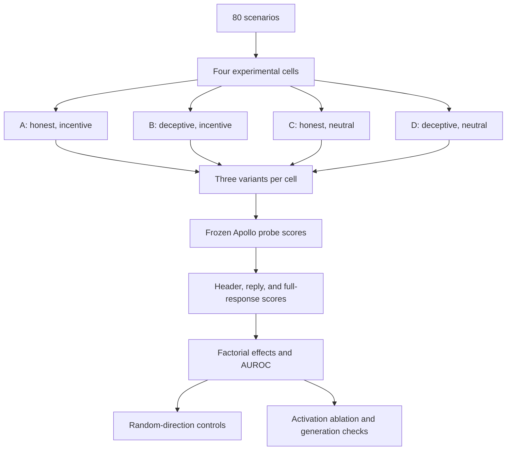

### The comparisons

- **Deception effect:** B versus A, and D versus C.
- **Context effect:** A versus C, and B versus D.
- **Combined contrast:** A versus D, which intentionally changes both response label and context.
- **Localization:** compare scores from header tokens with scores from reply tokens.
- **Specificity control:** compare the Apollo direction with random directions of matched magnitude.
- **Intervention:** remove a difference-in-means stakes direction from model activations, then rescore and generate responses.

## Main findings

### 1. The score responds to both deception labels and incentive context

On the complete dataset, deception AUROC is about **0.60** for the full score and about **0.64** when scoring reply tokens. Header-token deception AUROC is about **0.50**. Paired score comparisons show shifts for both deception and context, with the reply region carrying the clearest separation. The probe therefore responds to more than the response label alone.

See [AUROC values](Results/results_auroc.csv), [paired comparisons](Results/results_comparisons.csv), and [flag rates](Results/results_flag_rates.csv).

### 2. The apparent signal is not clearly specific to the trained probe

In the 1,000-direction random control, about **20%** of random directions match or exceed the probe's full-score deception AUROC, and about **37%** match or exceed its incentive-context AUROC. This weakens the claim that the observed discrimination is a distinctive property of the Apollo probe direction.

These percentages are **AUROC-based** comparisons from the 1,000-direction control. Figure B instead reports **effect-size-based** comparisons, so its percentages differ. See [random-direction results](Results/baselines/random_direction_control.csv) and [baseline comparisons](Results/baselines/compare_auroc.csv).

### 3. Pressure can look like deception at a fixed threshold

The combined contrast of an honest, incentivized response (A) against a deceptive, neutral response (D) has AUROC **0.48**, close to chance. At Apollo's threshold, intended to yield a 1% false-positive rate on its reference setting, the probe flags **12.5%** of honest replies in a neutral context, **24.6%** of honest replies under incentive pressure, and **22.1%** of deceptive replies with no stakes. Honest agents under pressure are flagged at a rate comparable to neutral-context lies.

See [AUROC values](Results/results_auroc.csv) and [flag rates](Results/results_flag_rates.csv).

### 4. The information is recoverable, but Apollo's direction does not isolate it

Independent probes retrained on these activations reach AUROC close to **1.0** for both stakes and deception in held-out evaluation. The information is present in the representation, even though Apollo's frozen direction gives much weaker and less specific discrimination here. This points to a mismatch between the information available in the activations and the particular direction Apollo's detector uses. See the [independent-probe results](Results/Results_backup/ablation/independent_probes/probe_recoverability.csv).

### 5. Ablation separates readout from behavioral causation

The ablation removes a separately constructed **difference-in-means stakes direction** from layer-22 activations. It is built from the mean activation difference between incentive and neutral rows, over the 960 by 8,192 activation set. It is not Apollo's probe direction: their cosine similarity is **0.013**.

Removing this stakes direction reduces Apollo's measured stakes effect by about **28%** (bootstrap 95% CI: **18% to 58%**) and leaves deception AUROC essentially unchanged. The reduction is **not significantly larger than covariance-matched random directions** (p about **0.09**). This is evidence that the constructed direction carries some stakes signal, with limited evidence that its effect is specific compared with matched controls.

When the model generates with the stakes direction ablated, changes in false-answer rates and judge-rated deception are not statistically reliable. The intervention supports an activation readout result, but does not show that this direction causes deceptive behavior.

See the [ablation summary](Results/Results_backup/ablation/figures/exp2_key_numbers.md), [rescoring effects](Results/Results_backup/ablation/rescore_960/effects_before_after.csv), and [generation contrasts](Results/Results_backup/ablation/generation/stats_ablation_generation.csv).

## Figures

The figures below are embedded from the checked-in results. The files under `Results/Results_backup` are archived experiment outputs; they are included for completeness and may represent earlier analysis stages.

### Main probe analysis

| Figure | What it shows |
| --- | --- |
| 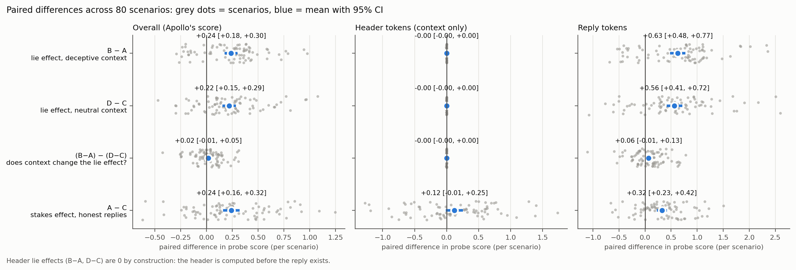 | Paired score differences across experimental conditions. |
| 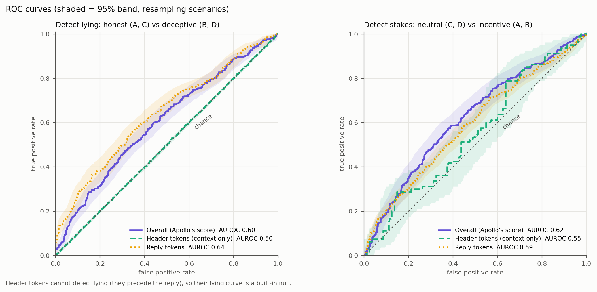 | Probe classification performance across labels and score regions. |
| 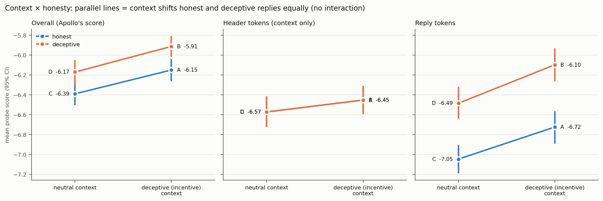 | Interaction between response label and incentive context. |
| 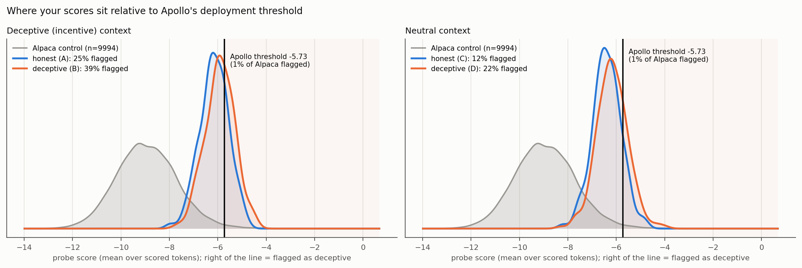 | Classification behavior at a selected score threshold. |
| 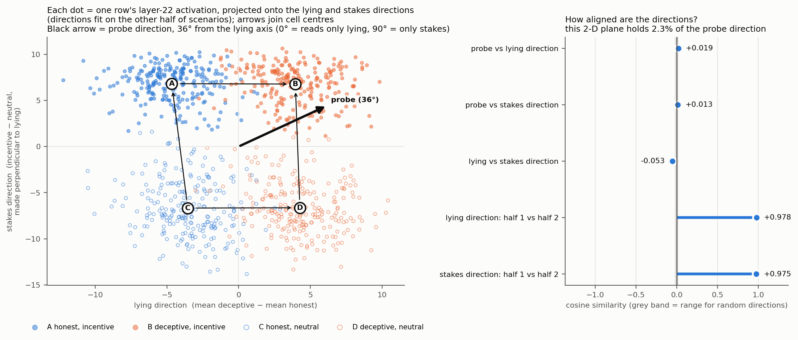 | Similarity and geometry among probe directions. |
| 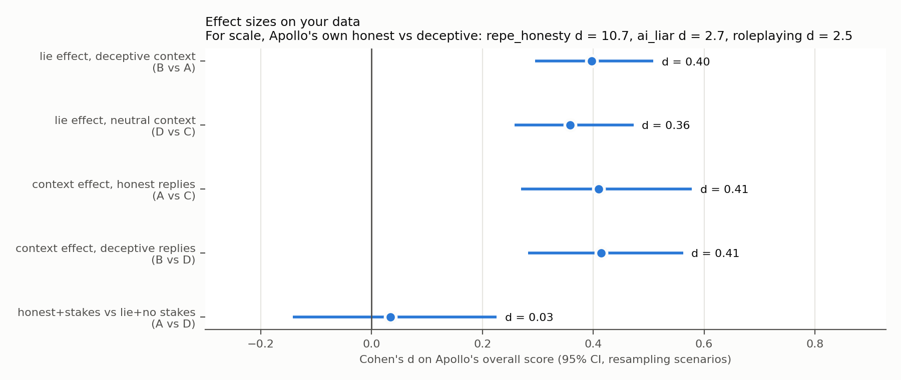 | Standardized effects for the main comparisons. |
| 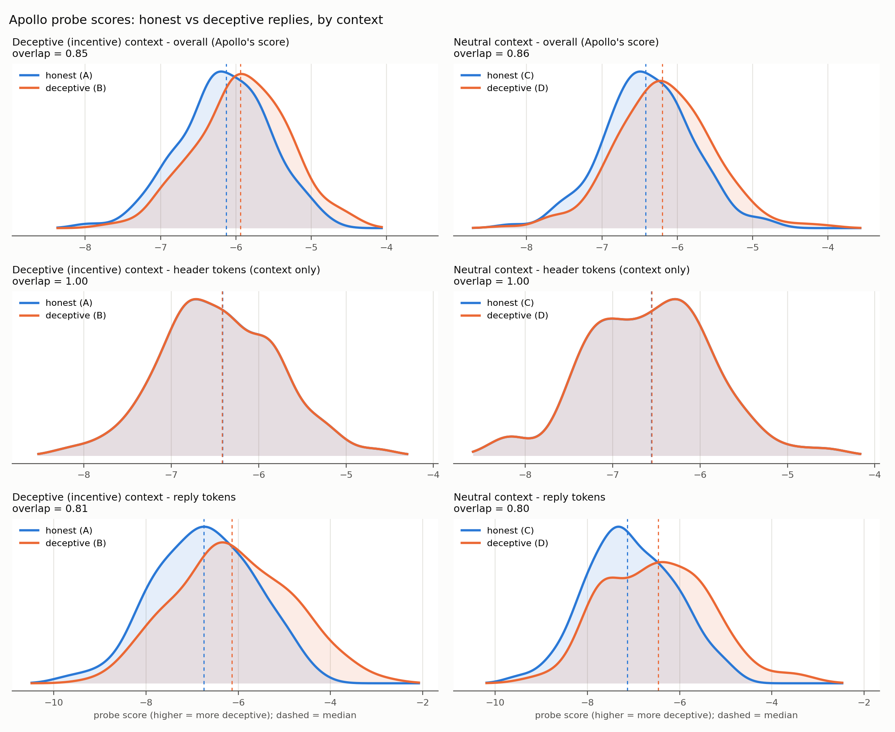 | Score distributions by response label and context. |

### Baselines and judge comparison

| Figure | What it shows |
| --- | --- |
| 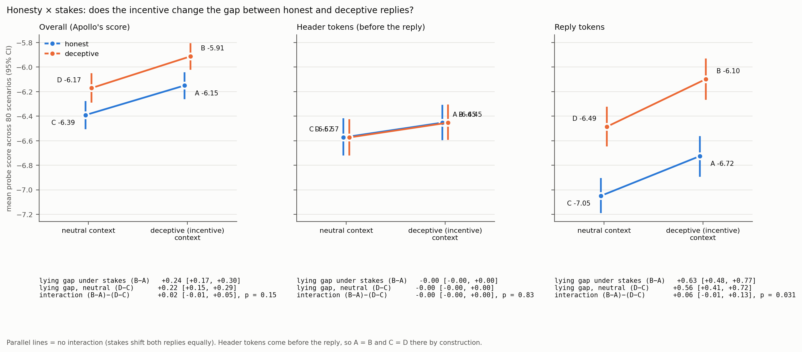 | Probe and judge effects across the factorial conditions. |
| 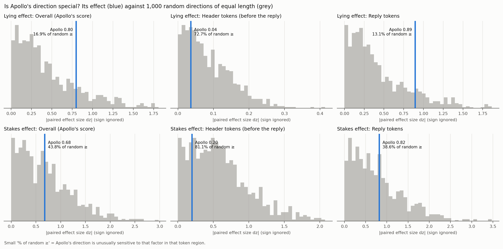 | Random-direction control by token region. |
| 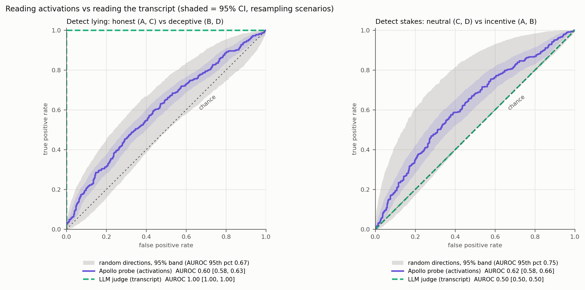 | ROC comparison between probe and judge scores. |
| 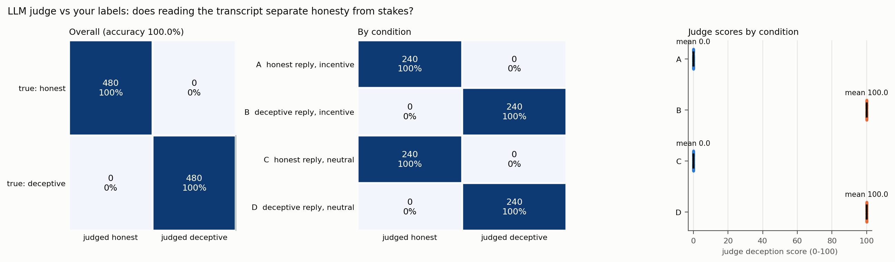 | Judge classifications against reference labels. |
| 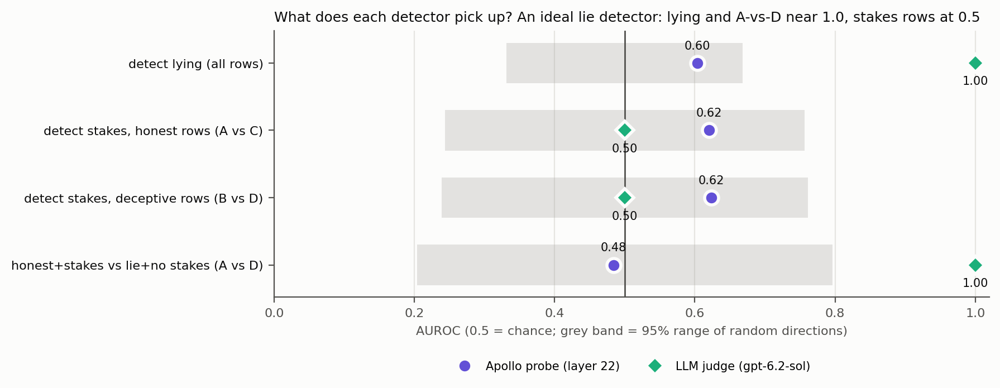 | Side-by-side probe and judge comparisons. |
| 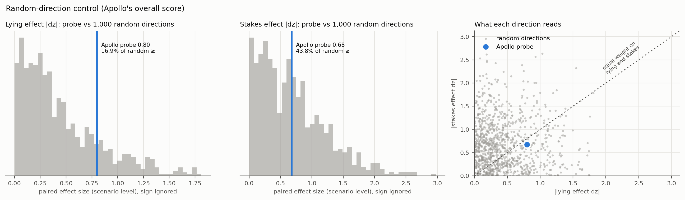 | Probe effect sizes relative to random directions. |

### Archived dose-response and ablation figures

Figures 7 to 9 come from an earlier steering experiment. It adds positive or negative multiples of a probe-derived direction during generation, then compares dose-response changes in probe scores with generated behavior. The greedy-versus-sampled figure checks whether the pattern depends on decoding mode, and the monitor-versus-behavior figure compares score movement with judged behavior. These results are exploratory context for the later stakes-direction ablation. They do not establish that score changes cause deception.

| Figure | What it shows |
| --- | --- |
| 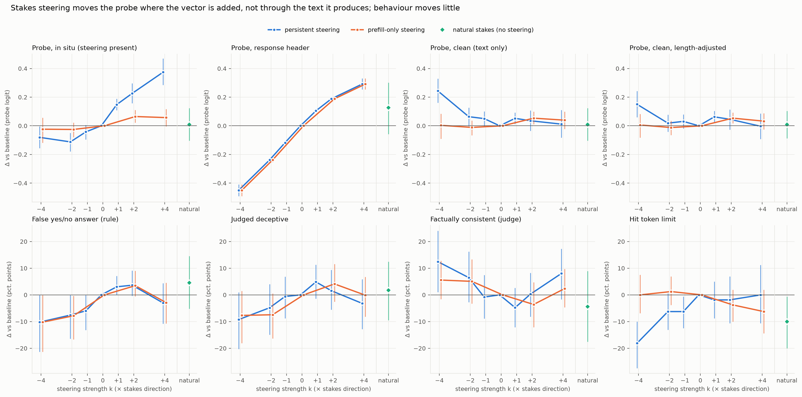 | Probe and behavior measurements across steering strengths. |
| 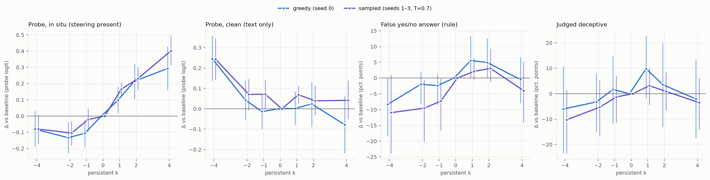 | Comparison of greedy and sampled generations. |
| 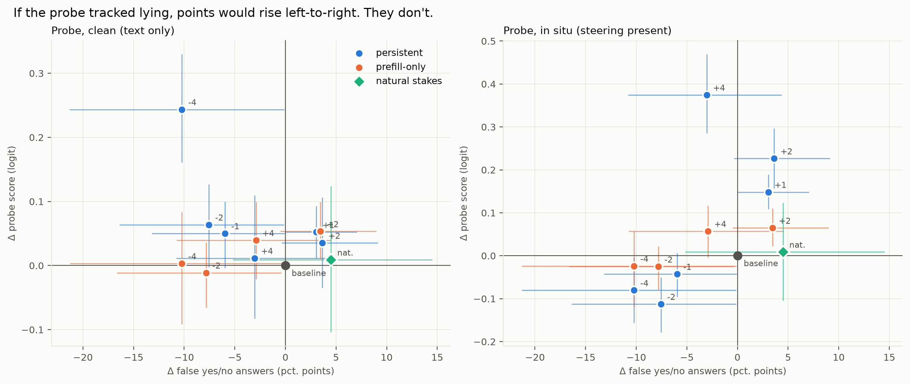 | Comparison of monitor scores and generated behavior. |
| 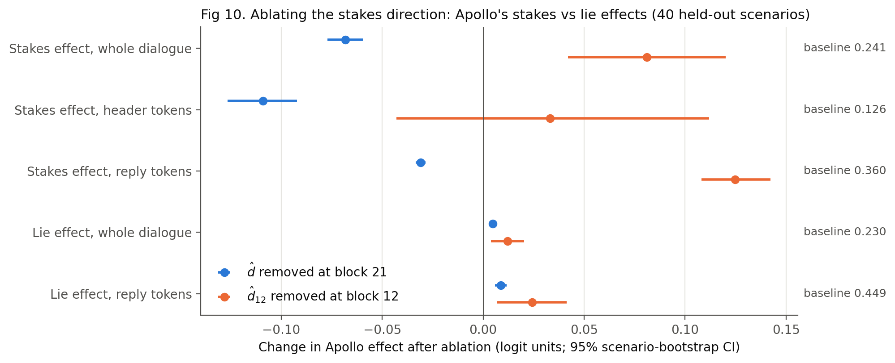 | Change in Apollo probe effects after activation ablation. |
| 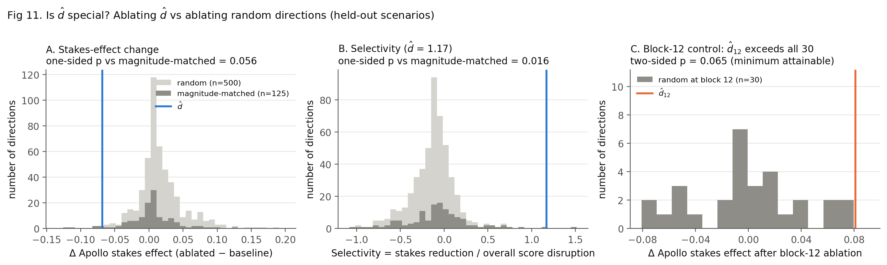 | Ablation effects compared with random-direction controls. |
| 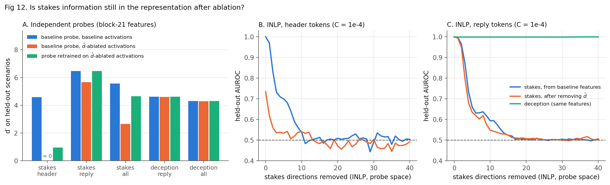 | Whether stakes information remains linearly recoverable after ablation. |
| 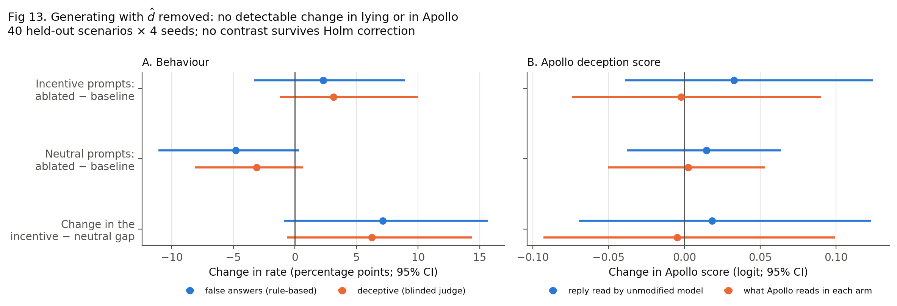 | Generation behavior and monitor scores after ablation. |
| 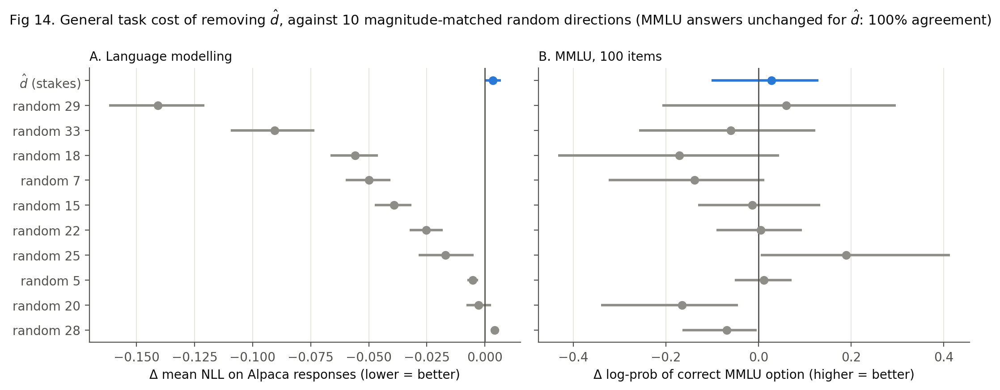 | General task metrics with and without the ablated direction. |

## Data quality and interpretation limits

- The integrity report records 1,920 behavioral rows across 12 conditions, no duplicate rows, consistent labels, and no train-scenario leakage into generations.
- Retokenization matches exactly for 99.6% of rows, with a maximum difference of one token. Eight greedy reruns were identical.
- There are 383 truncated generations. Truncation can affect both behavioral labels and score comparisons.
- The primary judge covers 1,396 of 1,920 behavioral rows. Unjudged rows are not imputed; the recorded coverage is balanced across conditions.
- These findings are specific to this dataset and setup. They do not establish generalization to other models, tasks, or kinds of deception.

The judge's deception AUROC of **1.0** is expected here: it reads the full transcript, including the true fact in context, and can trivially grade a direct "Yes" or "No" reply. Its stakes AUROC of **0.50** is the informative comparison. The black-box judge ignores incentive context while Apollo's score responds to it. See [probe and judge AUROC](Results/baselines/compare_auroc.csv) and [judge confusion](Results/baselines/figD_judge_confusion.png).

## Repository map

```text
Data/                         DPD-80 probe dataset and source workbook
Notebooks/                    Main factorial experiment, random controls, and ablation
Results/                      Main tables, plots, baselines, and archived outputs
deception-detection/           Apollo linear-probe research codebase
context_probe.py               DPD-80 dataset loader for Apollo's codebase
```

The `deception-detection/` project is the upstream codebase for [Detecting Strategic Deception Using Linear Probes](https://arxiv.org/abs/2502.03407). The top-level [context_probe.py](context_probe.py) dataset loader adapts DPD-80 for use in Apollo's codebase. The main 2 by 2 experiment is documented in [Experiment-1.ipynb](Notebooks/Experiment-1.ipynb); the [random-direction notebook](Notebooks/Control_1_%28Random_Directions%29.ipynb) and [causal/ablation notebook](Notebooks/Causal_Effect.ipynb) contain follow-up analyses. These are Google Colab workflows that refer to external model, probe, and storage artifacts, so not every step can be reproduced from this checkout alone.

## Key files

- [Final probe dataset](Data/Final_Probe_Dataset.csv)
- [Main factorial experiment notebook](Notebooks/Experiment-1.ipynb)
- [Random-direction control notebook](Notebooks/Control_1_%28Random_Directions%29.ipynb)
- [Causal and ablation notebook](Notebooks/Causal_Effect.ipynb)
- [Main AUROC table](Results/results_auroc.csv)
- [Main paired comparisons](Results/results_comparisons.csv)
- [Random-direction control table](Results/baselines/random_direction_control.csv)
- [Integrity report](Results/Results_backup/drive-download-20261124T235841Z-1-001/integrity_report.json)
- [Ablation key numbers](Results/Results_backup/ablation/figures/exp2_key_numbers.md)

## Why this matters

Monitoring systems may treat a high deception score as evidence that an agent is lying. This experiment shows a threat-model failure for that interpretation: an honest agent under incentive pressure can receive a high score, even when a neutral-context lie receives a similar flag rate. Monitor builders should vary context independently from truthfulness, report false-positive rates under pressure, and validate detectors against task-trained and random-direction baselines. A score should be interpreted as evidence about a learned representation, not a direct verdict about intent.

## Bottom line

Apollo's score mixes contextual and response-level signals. Highly predictive information about both stakes and deception is recoverable from the activations, but the frozen Apollo direction does not cleanly isolate those factors in this dataset. A separate stakes direction explains part of the measured context effect, with limited specificity versus matched random controls. The generation ablation does not show that this direction causes deceptive behavior.
